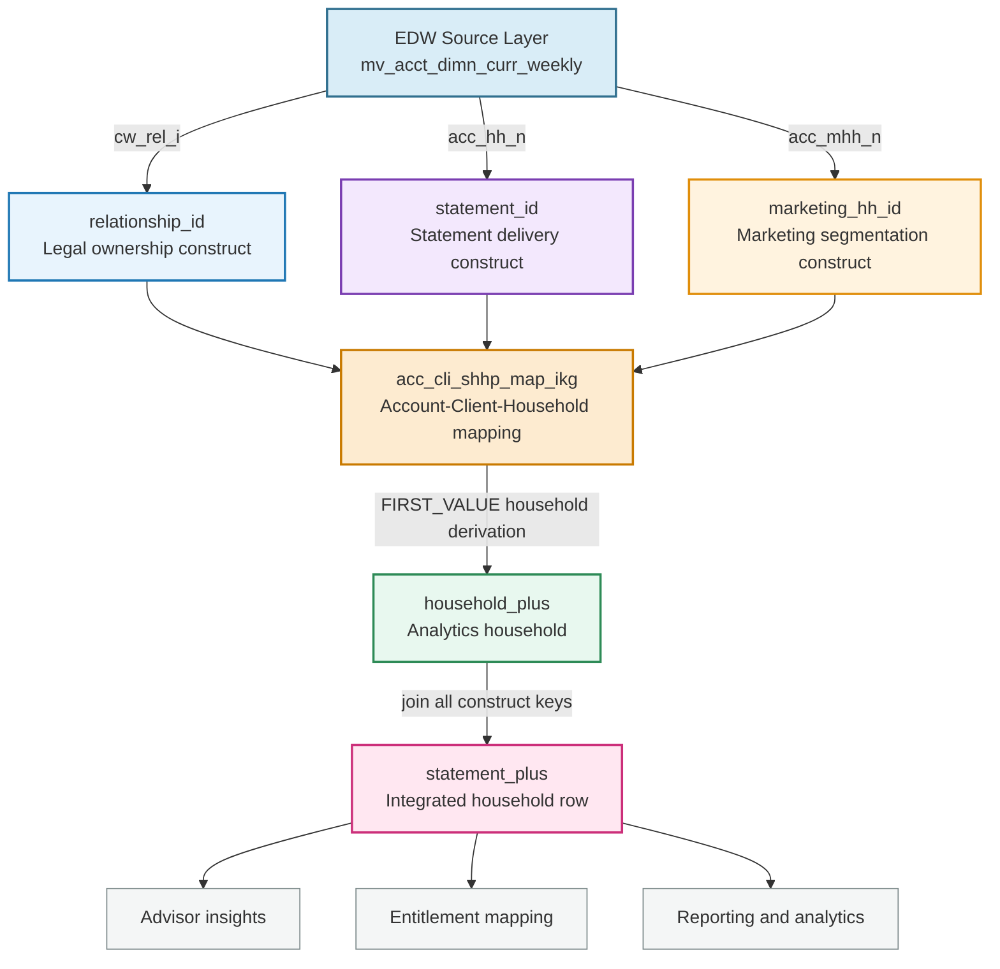
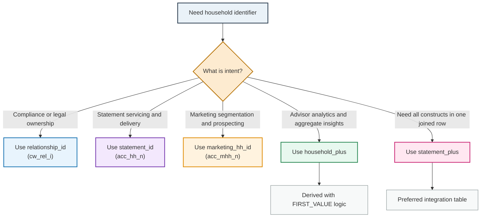

# IKG skills and standards

_Merged from 6 files on 2026-10-23; `household_definitions.md`, `statement_household.md` and `ikg_metadata_standards.md` are already contained in the IKG Knowledge Skills section and are not repeated. Edit THIS file from now on, or edit the originals and re-run `python app_kpack.py merge-skills --system ikg`._

## Contents

- [Business Definitions](#business-definitions) - `business_definitions.md`
- [Household Domain](#household-domain) - `household_domain.md`
- [Ikg Advisor Hierarchy](#ikg-advisor-hierarchy) - `ikg_advisor_hierarchy.md`
- [Ikg Conventions](#ikg-conventions) - `ikg_conventions.md`
- [Ikg Fa Ta Entitlement Model](#ikg-fa-ta-entitlement-model) - `ikg_fa_ta_entitlement_model.md`
- [Ikg Knowledge Skills](#ikg-knowledge-skills) - `ikg_knowledge_skills.md`

## Business Definitions

_source: `business_definitions.md`_

<!-- Every definition in this file is sent to the model with each request.
     Add firm definitions here (household types, segments, products, rule terms).
     Keep each definition short and factual. -->

### Statement Householding (Statement Household / shh / Statement Plus)
Statement Householding is the ability to group multiple account statements with the same account
registration address in a single envelope. Accounts may be householded either automatically during the
nightly systematic update process (i.e. nightly batch cycle), or manually using the online system.
Consent requirements (to be included in the same envelope) are calculated based on the tax
identification number on the accounts. Accounts marked as Include are mailed together; those marked
Pending or Exclude are not.

### Household key (acc_mhh_n)
acc_mhh_n is the statement household grouping key (sourced from household_plus). It is NOT the marketing
household; the marketing household is tracked separately as acc_market_hh_n (sourced from marketing_hh_id).
Attributes prefixed mhh_ are aggregated at the acc_mhh_n (statement household) level.

### Profile table
A profile table (`*_profile_curr_ikg`) is a weekly snapshot (profile_date = run date, YYYYMMDD) of
derived attributes per business entity, used by the Insight Knowledge Graph (IKG) to trigger and
narrate advisor insights (ODM rules / NLG).

## Household Domain

_source: `household_domain.md`_

Detailed reference for household constructs, lineage, and developer construct selection.

### Construct Lineage



### Developer Construct Decision Tree



## Ikg Advisor Hierarchy

_source: `ikg_advisor_hierarchy.md`_

### Authority

This document is authoritative domain context for the advisor organizational hierarchy in IKG.

All agents must consult this document before implementing advisor-level reporting, hierarchy-aware entitlement logic, branch or market rollup queries, team structure queries, or NLG recipient scope decisions.

---

### Hierarchy Overview

The IKG advisor hierarchy has five primary levels:

```
GPN / Home Office
      ↓
   Market
      ↓
   Branch (FL)
      ↓
 FA Team (FA + TA)
      ↓
  Individual FA
```

Each level carries distinct entitlement scope, data access, and reporting responsibilities.

---

### Roles and Scope

#### FA – Financial Advisor

- Primary relationship owner for client households.
- Entitled to households via compensation split (via `mv_fa_split_commis_fact_weekly`).
- Identified via `fa_details_ikg`.
- Entitlement: `si_pilot_fa_shp_map`.

Key fields:
| Field | Source | Description |
|-------|--------|-------------|
| `fa_code` | `mv_fa_dimn_curr_weekly` | Primary FA identifier |
| `compensation_key` | `mv_fa_split_commis_fact_weekly` | Compensation routing key |
| `team_code` | `mv_fa_team_dimn_weekly` | Team membership |
| `branch_code` | `mv_branch_division_dimn_curr_weekly` | Branch location |

---

#### TA – Team Assistant

- Supports one or more FAs within a team.
- Entitled to households via team relationship to FA (not independent splits).
- Identified via `support_staff_ikg`.
- Entitlement: `si_pilot_ta_shp_map`.
- TA entitlement scope must be a subset of (or equal to) the FA team's scope.

Key fields:
| Field | Source | Description |
|-------|--------|-------------|
| `ta_code` | `support_staff_ikg` | TA identifier |
| `fa_team_code` | `mv_fa_team_dimn_weekly` | Team the TA supports |

---

#### FL – Field Leader

- Supervisory role over a group of FAs.
- Entitled to all households managed by FAs in their supervised team.
- Identified via `fl_master_list_ikg`.
- Entitlement: `si_pilot_fl_shp_map`.

Key fields:
| Field | Source | Description |
|-------|--------|-------------|
| `fl_code` | `fl_master_list_ikg` | FL identifier |
| `supervised_fa_codes` | `fl_master_list_ikg` | FAs under this FL's leadership |
| `branch_code` | `mv_branch_division_dimn_curr_weekly` | Branch scope |

---

#### BDO – Business Development Officer

- Operates at branch or market geography level.
- Entitled via branch/market scope rather than individual FA splits.
- Entitlement: `si_pilot_bdo_shp_map`.

Key fields:
| Field | Source | Description |
|-------|--------|-------------|
| `bdo_code` | `bodi_branch_contacts` | BDO identifier |
| `branch_code` | `mv_branch_division_dimn_curr_weekly` | Branch or market scope |

---

#### GPN – Global Private Net

- Specialized entitlement tier for high-net-worth segments.
- Operates above standard FA team structure.
- Entitlement scope may cross team and branch boundaries.

---

### Team Structure

Teams are defined in `mv_fa_team_dimn_weekly`.

A team consists of:
- One or more FAs (primary relationship holders)
- Zero or more TAs (support staff)
- One FL (team leader)

Team membership drives TA entitlement inheritance. A TA inherits access to all households accessible by the FAs in their team.

`team_to_splits_ikg` maps team membership to compensation split records, enabling team-level entitlement aggregation.

---

### Branch and Division Hierarchy

```
Division
   ↓
Market
   ↓
Branch
   ↓
FA Team
```

Source: `mv_branch_division_dimn_curr_weekly`

BDO entitlement scope is defined at the branch or market level.

FL scope is typically defined at branch level but may span multiple branches in some organizational structures.

---

### Hierarchy-Aware Entitlement Source Mapping

| Role | Identity Source | Entitlement Source |
|------|-----------------|--------------------|
| FA | `fa_details_ikg` | `si_pilot_fa_shp_map` |
| TA | `support_staff_ikg` | `si_pilot_ta_shp_map` |
| FL | `fl_master_list_ikg` | `si_pilot_fl_shp_map` |
| BDO | `bodi_branch_contacts` | `si_pilot_bdo_shp_map` |
| All | – | `si_pilot_all_ta_fa_fl_shp_map` |

`si_pilot_all_ta_fa_fl_shp_map` is the operational master for all roles combined.
`si_pilot_all_ta_fa_fl_shp_map_hist` maintains history for audit and change tracking.

---

### Hierarchy in NLG Distribution

NLG distribution uses hierarchy to determine recipient scope:

- FA recipient list: from `si_pilot_fa_shp_map`.
- TA recipient list: from `si_pilot_ta_shp_map`, filtered by `si_pilot_fa_ta_map`.
- FL recipient list: from `si_pilot_fl_shp_map`.
- BDO recipient list: from `si_pilot_bdo_shp_map`.

After building the base list, FGA filtering is applied. See `fga_entitlement_model.md` for FGA-specific suppression.

---

### Hierarchy in Reporting

Aggregated reporting (branch summary, market summary, leadership views) must roll up through the hierarchy using `mv_branch_division_dimn_curr_weekly`.

Do not build hierarchy from raw `mv_fa_dimn_curr_weekly` joins alone. The branch/division dimension provides the authoritative organizational rollup.

---

### EMPL_DIMN_CURR

`EMPL_DIMN_CURR` provides employee-level records that bridge HR data to advisor identifiers.

Used when:
- Resolving advisor identity from HR/employment records
- Connecting TA and FA to the same employment record
- Identifying newly hired or terminated advisors

---

### Common Mistakes

1. Building TA entitlement from FA splits directly, bypassing `si_pilot_ta_shp_map`.
2. Treating FL as having the same entitlement path as FA.
3. Hardcoding branch hierarchy relationships instead of joining `mv_branch_division_dimn_curr_weekly`.
4. Not checking `EMPL_DIMN_CURR` when advisor identity cannot be resolved from standard FA dimension.
5. Omitting BDO from recipient lists when BDO entitlement is in scope.

---

### Activation Triggers

This document must be consulted when requests contain:

`FA hierarchy`, `TA hierarchy`, `FL hierarchy`, `BDO`, `advisor team`, `branch hierarchy`, `market hierarchy`, `team structure`, `team code`, `compensation hierarchy`, `advisor org`, `supervisor`, `leadership`, `field leader`, `branch rollup`, `market rollup`, `division`, `organizational hierarchy`, `mv_branch_division_dimn_curr_weekly`, `mv_fa_team_dimn_weekly`, `fl_master_list_ikg`, `support_staff_ikg`, `fa_details_ikg`

## Ikg Conventions

_source: `ikg_conventions.md`_

### Layout
- `dags/ikg/dags/*.py` - Airflow DAGs. The weekly pipeline is `ikg_data_refresh.py`: one `TaskGroup` per SQL folder,
  one `PostgresOperator(task_id='<file stem>', sql='<folder>/<file>.sql', postgres_conn_id=postgres_conn_id, params=props)`
  per SQL file, registered in the group's `task_map` and `all_task_map`. Task dependencies are NOT written by hand:
  `props['task_dependency']` (Airflow variable `IKG_TASK_DEP_DICT`, rebuilt by `ikg_task_dependency_refresh.py` from the
  SQL sources/targets) wires upstream tasks, so a new SQL file only needs its operator line + task_map entry.
- `dags/ikg/scripts/sql/<folder>/<table>.sql` - one SQL file = one output table, file name = table name.
  Folders group a subject (ikg_cash_distribution, ikg_base_feature, ikg_housekeeping_checklist, ...). A new subject gets a
  new folder + a new TaskGroup; a new column for an existing subject goes into that subject's folder.
- `dags/ikg/scripts/sql/ikg_create_profiles/<entity>_profile_curr_ikg.sql` - the profile tables (one per entity grain:
  household, client, account, fl_fa, prospect, ...). Columns are SELECTed from intermediate `*_ikg` tables joined on the
  entity key; the script declares the column list (CREATE TABLE ... (col type, ...)) then INSERTs / CREATE AS.
- `dags/ikg/scripts/sql/ikg_create_profiles_history/<entity>_profile_ikg.sql` - weekly history of each profile table
  (INSERT INTO <entity>_profile_ikg SELECT ... FROM <entity>_profile_curr_ikg). Every new profile table needs one.
  History scripts are NOT tasks of `ikg_data_refresh.py`: they are run by the separate DAG `ikg_create_profiles_history.py`
  (triggered by `ikg_master.py` after the refresh), which reads `scripts/python/ikg_adls_archive/table_config.py`
  (`TABLE_CONFIG`: one entry per profile table with partition_column / filter_column). A NEW profile table therefore
  also needs its `TABLE_CONFIG` entry (copy an existing one) - never a PostgresOperator in ikg_data_refresh.py.
- `dags/ikg/scripts/python/...` - Python helpers (ingestion, props, validation). `props.get_airflow_variables()` exposes
  the Airflow variables: EDW_INPUT_SCHEMA, IKG_SCHEMA (sandbox_ikg_pre_prd in UAT / core_ikg in PROD), IKG_PROFILE_DATE,
  IKG_PREV_PROFILE_DATE, IKG_TABLE_OWNER_GROUP, IKG_TABLE_READER_GROUP, IKG_INGESTION_SCHEMA, IKG_VENDOR_SCHEMA, ...
- `dags/ikg/scripts/R/` - legacy; no new R code.

### SQL file pattern (intermediate table)
```sql
DROP TABLE IF EXISTS {{params.IKG_SCHEMA}}.<table>_ikg;

CREATE TABLE {{params.IKG_SCHEMA}}.<table>_ikg AS
SELECT
    <key columns>,
    <measures>,
    <key> AS ikg_key,
    {{params.IKG_PROFILE_DATE}}::text AS profile_date
FROM {{params.IKG_SCHEMA}}.<source_ikg_table> s
...
WHERE profile_date = '{{params.IKG_PROFILE_DATE}}'
DISTRIBUTED BY (<key>);

ALTER TABLE {{params.IKG_SCHEMA}}.<table>_ikg OWNER TO {{params.IKG_TABLE_OWNER_GROUP}};
GRANT SELECT ON {{params.IKG_SCHEMA}}.<table>_ikg TO {{params.IKG_TABLE_READER_GROUP}};
```
- EDW/ADW source tables: `{{params.EDW_INPUT_SCHEMA}}.<table>` (never the literal schema core_wma_shared).
- Base ids: `master_ids_ikg` / `master_ids_curr_ikg` (account -> client -> household keys), `statement_plus_ids`,
  `intl_household_plus_ids` (acc_mhh_n = household_plus). Entity keys: acc_mhh_n (statement household), ip_cli_i
  (client), acc_i / acc_n (account), fa_i (advisor). Household aggregates are built from account-level `*_acc_*` tables.
- NEVER read a `*_profile_curr_ikg` / `*_profile_ikg` table inside an IKG script. If a story needs a column that only a
  profile table has, trace that column to its producing intermediate table (lineage) and read that table, or build the
  column in a new intermediate table from the original sources.
- Column naming: `<grain prefix>_<measure>_<window>`: `mhh_` household, `acc_` account, `cli_` / `ip_` client, `fa_`
  advisor; flags `has_` / `is_` (1/0), counts `_cnt`, amounts `_a` / `_val`, dates `_d`, windows `_4w`, `_ytd`, `_boy`,
  `_prev_year`, lags `_lag4w`. Keep abbreviations from the glossary.
- Every table ends with the OWNER / GRANT pair. DISTRIBUTED BY the key used in downstream joins.

### Rule of thumb: logic in intermediate tables, profile scripts simple
All derivation (joins across sources, aggregation, CASE, windows) is done in `<subject>/<table>_ikg.sql` at the
profile's grain. The profile script only LEFT JOINs that table on the entity key and lists the column. A script
given in the story is ported into the intermediate table file, not into the profile script.

### Adding a column to a profile table (typical story)
1. Build (or extend) the intermediate table in the subject folder (`<subject>/<table>_ikg.sql`).
2. Add the column to the profile script in `ikg_create_profiles/<entity>_profile_curr_ikg.sql` (column DDL + select
   expression, LEFT JOIN the intermediate table on the entity key; COALESCE for flags/counts).
3. Add the column to the history script in `ikg_create_profiles_history/<entity>_profile_ikg.sql`.
4. Register any new SQL file as a task in `ikg_data_refresh.py` (operator + task_map). No dependency edits.
5. If the column is needed at another grain (household vs account), aggregate in a `*_mhh_agg_ikg` style table.

### New profile table
- `ikg_create_profiles/<entity>_profile_curr_ikg.sql` + `ikg_create_profiles_history/<entity>_profile_ikg.sql` + tasks
  in both task groups; include `ikg_key`, `profile_date`, the entity keys; DISTRIBUTED BY the entity key.

### Validation checklist for every change
- performance: filter by profile_date early, aggregate before joining, distribute on the join key, no cross joins;
- impact: list every script reading a changed table (consumers) and every DAG task touched;
- review queries: row counts vs previous profile date, null share of the new column, key uniqueness at the grain.

## Ikg Fa Ta Entitlement Model

_source: `ikg_fa_ta_entitlement_model.md`_

### Authority

This is the authoritative entitlement domain reference for all STAAT, IKG, Orbit, NLG, Insight Distribution, Reporting, and Entitlement-related development in IKG.

All agents, Copilot workflows, SQL generation, ETL development, reporting development, debugging workflows, and requirement analysis involving advisor entitlement, household access, recipient lists, insight delivery, or compensation splits must consult this document first.

---

### Mandatory Agent Behavior

Every IKG agent must consult this document before:

- Writing application code
- Creating SQL queries
- Building ETL pipelines
- Developing reporting solutions
- Implementing insight distribution logic
- Designing alerting systems
- Debugging recipient issues
- Investigating entitlement defects
- Creating advisor-facing products
- Implementing NLG functionality
- Designing APIs
- Reviewing pull requests
- Performing root cause analysis
- Responding to user entitlement questions

The entitlement document is a mandatory pre-condition, not optional reference.

---

### Domain Activation Triggers

This document must be automatically loaded when requests contain:

`FA`, `Financial Advisor`, `Team Assistant`, `TA`, `FL`, `Field Leader`, `BDO`, `GPN`, `entitlement`, `permissions`, `access`, `recipient`, `email distribution`, `insight distribution`, `ownership`, `assigned household`, `assigned advisor`, `compensation split`, `split percentage`, `household ownership`, `delivery`, `briefing delivery`, `JSON Insights`, `Statement Plus`, `household mapping`, `FA Alerts`, `Client Briefings`, `Distribution DB`, `NLG`

When any of these concepts are detected, this document must be consulted before generating code, producing SQL, designing solutions, recommending fixes, or explaining business logic.

---

### Core Principle

STAAT entitlement is household-centric.

**Governing rule:**

> "If a person has a valid relationship to a household through the entitlement model, they are entitled to receive insights associated with that household."

Access is determined through household mappings.

- Access is **NOT** determined individually per insight.
- Access is **NOT** determined per product type.
- Access is **NOT** determined through separate security tables.

The FA-to-household relationship drives entitlement.

**Exception:**

Financial Goal Analysis (FGA) uses additional entitlement logic documented separately in `ikg_fga_entitlement_model.md`.

Agents must not assume FGA follows standard entitlement behavior.

---

### Glossary of Roles

#### Financial Advisor (FA)

**Definition:**
Primary relationship manager for client households.

**Identifiers:**
- `fa_i` – internal FA identifier
- `fa_gpn` – Global Payroll Number for the FA

**Characteristics:**
- Compensation recipient
- Primary entitlement holder
- May have split relationships with other FAs

**Source:** EDW FA dimensions (`mv_fa_dimn_curr_weekly`)

---

#### Team Assistant (TA)

**Definition:**
Support associate working on behalf of one or more FAs.

**Examples:**
- Client Associate
- Wealth Management Associate
- Team Assistant
- Administrative Manager

**Flag:** `support_staff = 1`

**Purpose:**
May receive copies of advisor communications. TA entitlement is inherited through team relationship to FA – TAs do not hold independent entitlement.

---

#### Field Leader (FL)

**Definition:**
Market-level leadership role.

**Examples:**
- Market Director
- Market Executive
- Associate Market Executive

**Purpose:**
Receives market-level reporting. Entitled through supervisory relationship to FA teams within their market scope.

---

#### Business Development Officer (BDO)

**Definition:**
Home-office or specialty role included within entitlement distributions.

**Purpose:**
Participates in entitlement model through branch/market geography-based security mappings. Entitled at branch or market level rather than through individual FA splits.

---

#### GPN – Global Payroll Number

**Definition:**
Enterprise-wide employee identifier.

**Purpose:**
Used throughout entitlement tables as the primary person identifier. `fa_gpn` is the GPN for advisors; `GPN` links employee records across source systems.

---

#### household_plus

**Definition:**
Primary household identifier across IKG.

**Purpose:**
The entity used to determine entitlement ownership. When determining access rights, `household_plus` is the starting point for entitlement resolution.

For full `household_plus` definition and creation logic, see `ikg_household_domain.md`

---

### Source Systems

| Source | Purpose |
|--------|---------|
| `mv_fa_dimn_curr_weekly` | Current FA roster – FA identity, employment status, codes |
| `mv_fa_team_dimn_weekly` | FA team structure – team membership, team codes |
| `mv_fa_split_commis_fact_weekly` | Compensation splits – FA split percentages per account |
| `mv_acct_dimn_curr_weekly` | Account hierarchy, household constructs, branch mapping |
| `mv_branch_division_dimn_curr_weekly` | Branch and division hierarchy for BDO/FL geography mapping |
| `mv_cust_dimn_curr_weekly` | Client metadata, demographics, classification |
| `dim_fa_security_cw` | Primary entitlement security source from ConsultWorks |
| `dim_fa_home_office_security_cw` | Home-office entitlement override source |
| `EMPL_DIMN_CURR` | Employee data source; links HR records to advisor identifiers |
| `bodi_branch_contacts` | Field leader identification and branch contact data |

**Agent guidance:**
Entitlement investigations should trace back to source systems before assuming data quality issues. Do not modify entitlement logic without first confirming what each source system provides.

---

### Entitlement Data Model

#### Layer 1: Identity Tables

These tables establish who each person is and what team they belong to.

##### fa_details_ikg

Canonical FA reference table.

Contains:
- GPN (`fa_gpn`)
- Name
- Email
- Team identifiers
- Production identifiers
- International indicators
- Compensation keys

**Agent guidance:** All FA identity resolution starts here. If an advisor cannot be found in `fa_details_ikg`, they are not a recognized FA in IKG.

---

##### support_staff_ikg

Canonical support staff reference table.

Contains:
- Support staff identification
- TA classification (`support_staff = 1`)
- FL classification
- BDO classification
- Team association

---

##### fl_master_list_ikg

Canonical field leader table.

Contains supervised FA codes and market scope for each FL.

---

##### team_to_splits_ikg

Core entitlement crosswalk.

**Purpose:**
Maps branch teams to entitled FA GPNs.

This table is the foundation of entitlement assignment. It connects the team structure (from `mv_fa_team_dimn_weekly`) to compensation-based ownership.

**Agent guidance:**
Many entitlement questions ultimately trace back to `team_to_splits_ikg`. When investigating why an FA is or is not entitled to a household, validate their team-to-splits mapping before examining downstream tables.

---

#### Layer 2: Central Entitlement Table

##### shhp_ids_fa_map_ikg

**This is the most important entitlement table in IKG.**

**Purpose:**
Connects accounts, households, FAs, TAs, FLs, and BDOs into a single entitlement map.

**Computes:**
- `has_all_accounts` – whether the person covers every account within the household
- `split_greater_than_fifteen` – whether compensation split exceeds 15%
- `split_greater_than_zero` – whether any valid split relationship exists
- `is_excluded_household` – whether household is excluded from product eligibility
- `is_wac_mhh` – whether household is a WAC marketing household

**Agent guidance:**
Most entitlement investigations should begin here. `shhp_ids_fa_map_ikg` is where the FA-to-household relationship is established. If it is not present here, it will not appear in downstream role maps.

---

#### Layer 3: Role-Specific Maps

##### si_pilot_fa_shp_map

FA-to-household entitlement table.

**Active conditions:**
- `is_fa = 1`
- `has_all_accounts = 1`
- `support_staff = 0`

Used for all FA insight delivery and most reporting products.

---

##### si_pilot_ta_shp_map

TA-to-household entitlement mapping.

Derived from FA team relationships. A TA's scope must be a subset of (or equal to) the FA team's household scope.

---

##### si_pilot_fl_shp_map

Field Leader entitlements.

Derived from FL supervisory relationship to FA teams within their market scope.

---

##### si_pilot_bdo_shp_map

BDO entitlements.

Derived from branch/market geography. BDOs receive household access across their branch/market region.

---

#### Layer 4: Master Entitlement Map

##### si_pilot_all_ta_fa_fl_shp_map

**This is the authoritative entitlement population used by NLG and most downstream systems.**

Contains all roles:
- FA
- TA
- FL
- BDO

**Agent guidance:**
If determining who can receive household insights, start here. This is the single source of truth for active entitlements across all roles.

---

#### Layer 5: Historical Entitlement

##### si_pilot_all_ta_fa_fl_shp_map_hist

Weekly entitlement history.

**Usage:**
- Audits
- Root cause investigations
- Historical access reviews
- Comparing entitlement state across run dates

---

### NLG-Specific Tables

#### si_pilot_fa_ta_map

**Purpose:**
FA-to-TA relationship mapping.

Used to determine which TAs should receive copied communications.

**Agent guidance:**
Do not derive TA relationships from household mappings alone. Use this table. TA scope must be validated against FA scope – a TA cannot receive insights about households their supervising FA cannot access.

---

#### si_pilot_fa_shp_map_weighted_split

**Purpose:**
Calculates weighted household ownership per FA.

**Formula:**

```sql
weighted_split =
    SUM(split_percentage / 100 * acc_assets)
    /
    SUM(acc_assets)
-- PARTITION BY (household_plus, fa_gpn)
```

**Provides:**
- `weighted_split` – asset-weighted ownership percentage
- `FAs_Associated` – count of FAs with any split relationship to the household

**Agent guidance:**
Use `weighted_split` when ranking economic ownership or prioritizing primary advisor. Do not use raw split percentages for ownership prioritization – the weighted formula accounts for account-level asset values.

---

### Key Entitlement Flags

| Flag | Value | Meaning |
|------|-------|---------|
| `support_staff` | 0 | FA, FL, or BDO |
| `support_staff` | 1 | TA (support staff) |
| `has_all_accounts` | 1 | Person covers every account within the household – **foundational flag** |
| `split_greater_than_fifteen` | 1 | Compensation split exceeds 15%; required by FA Alerts |
| `split_greater_than_zero` | 1 | At least one valid split relationship exists |
| `is_excluded_household` | 1 | Household excluded from product eligibility |
| `is_wac_mhh` | 1 | WAC marketing household; passed downstream for WAC filtering |

**Agent guidance:**
`has_all_accounts = 1` is the foundational flag. All role maps filter on this. If it is not set, the advisor will not appear in any downstream entitlement map. Verify this flag first in any entitlement investigation.

---

### Eligibility vs Entitlement

| Concept | Definition |
|---------|------------|
| **Eligibility** | The advisor meets criteria to be considered for insights (e.g., `split_greater_than_fifteen`, active employment, active household). |
| **Entitlement** | The advisor has been granted access to a specific household in the entitlement layer. |

An advisor can be eligible but not yet entitled (entitlement refresh has not yet run, or household was recently assigned). Agents must not confuse these terms. An eligibility check alone is insufficient to confirm insight delivery.

**Entitlement and eligibility are separate concepts.** A user may be entitled but still not receive a product because eligibility filters block generation.

---

### Product Consumption Matrix

| Product | Role | Entitlement Source | Filter Condition |
|---------|------|--------------------|------------------|
| FA Alerts | FA | `si_pilot_fa_shp_map` | `split_greater_than_fifteen = 1` required |
| Client Briefings | FA | `si_pilot_fa_shp_map` | No minimum split threshold |
| JSON Insights Portal | All | `si_pilot_all_ta_fa_fl_shp_map` | Role-based view filtering |
| FL Talent Report | FL | `si_pilot_fl_shp_map` | FL supervisory scope |
| Distribution Database | All | `si_pilot_all_ta_fa_fl_shp_map` | Downstream NLG delivery |
| STAAT Pilot | FA | `si_pilot_fa_shp_map` | All-access pilot program |
| STAAT Pilot | TA | `si_pilot_ta_shp_map` | Inherits from FA team |
| STAAT Pilot | FL | `si_pilot_fl_shp_map` | Leadership scope |
| STAAT Pilot | BDO | `si_pilot_bdo_shp_map` | Geography scope |
| Banker Desktop | FA | `si_pilot_all_ta_fa_fl_shp_map` | Filtered to Banker context |
| NLG Distribution | FA | `si_pilot_fa_shp_map` | Recipient list generation |
| NLG Distribution | TA | `si_pilot_ta_shp_map` | After FGA filtering |
| NLG Distribution | FL | `si_pilot_fl_shp_map` | Leadership reports |

**Agent guidance:**
Different products consume different entitlement views and apply different flag filters. Do not assume all products use identical filters. Confirm the correct entitlement source and filter conditions for the target product before implementation.

---

### What the Model Does NOT Cover

The following are **not** handled by the core entitlement model:

- FA Pilot Enrollments
- FA Opt-Out Lists
- Minor Household Exclusions
- Fisher Business Agreement Exclusions
- WAC Exclusions
- MHH Asset Thresholds
- FGA Entitlements (see `ikg_fga_entitlement_model.md`)

**Agent guidance:**
A user may be fully entitled but still not receive a product because separate eligibility filters (opt-outs, exclusions, asset thresholds) block generation or delivery. Validate both entitlement and eligibility stages before concluding a recipient issue.

---

### Troubleshooting Workflow

When users report missing recipients, missing FA alerts, missing TA copies, missing client briefings, missing portal access, split discrepancies, household ownership conflicts, or entitlement mismatches, investigate in this order:

1. **`household_plus`** – Confirm household resolves correctly in `statement_plus`.
2. **`team_to_splits_ikg`** – Confirm team-to-splits mapping exists for the advisor.
3. **`shhp_ids_fa_map_ikg`** – Confirm FA-to-household mapping exists with `has_all_accounts = 1`.
4. **Role-specific map** – Confirm the person appears in the applicable role map (`si_pilot_fa_shp_map`, `si_pilot_ta_shp_map`, etc.).
5. **`si_pilot_all_ta_fa_fl_shp_map`** – Confirm the person appears in the master map.
6. **`si_pilot_fa_ta_map`** – If TA, confirm FA-to-TA relationship is valid.
7. **Pilot and exclusion tables** – Confirm no opt-out, exclusion, or eligibility filter is blocking delivery.

Do not assume data quality issues without validating the entitlement chain in full.

---

### Developer Guidance

Before implementing entitlement-related functionality:

1. Determine whether household entitlement (standard model) or FGA entitlement (separate model) is required.
2. Identify which entitlement table is authoritative for the target product.
3. Verify whether role-specific filtering applies (`support_staff`, `has_all_accounts`, split flags).
4. Verify whether `household_plus` linkage is required in the join.
5. Determine whether eligibility rules exist beyond entitlement (opt-outs, exclusions, thresholds).
6. Preserve entitlement lineage in all downstream systems – do not bypass intermediate tables.

Require all SQL, transformations, APIs, and reports to document entitlement assumptions. If entitlement behavior is assumed rather than confirmed from this document, that assumption must be documented in code comments and flagged for review.

---

### Recipient Investigation Workflow

When investigating why an advisor received or did not receive a specific insight narrative:

1. Confirm household is in `statement_plus` / `ikg_household_domain.md` constructs for the relevant period.
2. Confirm advisor-household mapping exists in the appropriate role map.
3. Confirm insight was generated for that household (`si_nlg_household_insights_in_json_active_curr`).
4. If advisor is a TA, confirm `si_pilot_fa_ta_map` aligns correctly.
5. For FGA insights, switch to `ikg_fga_entitlement_model.md` investigation path.
6. Confirm distribution job included the advisor in the recipient list.
7. Confirm no post-filtering rule excluded the advisor (FGA content filtering, email suppression, opt-out, eligibility exclusion).

## Ikg Knowledge Skills

_source: `ikg_knowledge_skills.md`_

_skill: `ikg-knowledge-skills` - Firm knowledge for the IKG profile tables - household definitions, statement household (acc_mhh_n), metadata writing standards_

This file is the single place for firm knowledge about the IKG profile tables (`core_ikg.*_profile_curr_ikg`).
It merges the former skill files `household_definitions.md`, `statement_household.md` and `ikg_metadata_standards.md`.
ODM and NLG knowledge live in `odm_knowledge_skill.md` and `nlg_knowledge_skill.md` next to this file.

Rules for maintaining this file: write facts plainly (the skill agent must quote them verbatim); put column
definitions as `column = meaning`, abbreviations as `abbr = Full Form`, code values as `column: CODE = meaning`.

### Household definitions

#### Statement Householding
Statement Householding is the ability to group multiple account statements with the same account
registration address in a single envelope. Accounts may be householded either automatically during the
nightly systematic update process (i.e. nightly batch cycle), or manually using the online system.
Consent requirements (to be included in the same envelope) are calculated based on the tax identification
number on the accounts. Accounts marked as Include are mailed together; those marked Pending or Exclude
are not.

#### Abbreviations
- shh = Statement Household
- mhh = Marketing Household (as a token in column names such as mhh_assets_curr the measures are computed at the household level keyed by acc_mhh_n)
- hh = Household
<!-- SME: add other household abbreviations here -->

### Statement household key (acc_mhh_n)
In all profile tables, acc_mhh_n - is this marketing household or statement household?

source - ubs_base_acc_features_ikg. Let's check that table's definition of acc_mhh_n.

This confirms it: acc_mhh_n = b.household_plus, while acc_market_hh_n is separately populated from b.marketing_hh_id. So acc_mhh_n is distinct from the marketing household ID - it's the "household_plus" value, which (per the lineage docs) is UBS's statement/household grouping key (distinct from marketing_hh_id).

acc_mhh_n = statement household (sourced from household_plus), not the marketing household. The marketing household is tracked separately as acc_market_hh_n (sourced from marketing_hh_id).

- acc_mhh_n = statement household identifier (household_plus); the key that joins household, client and account profile tables and the NLG narrative tables
- acc_market_hh_n = marketing household identifier (marketing_hh_id)
- ip_cli_i = client (involved party) identifier
- acc_i = account identifier
- fa_gpn = Financial Advisor GPN (global personnel number)
- fl_gpn = Field Leader GPN
- main_prospect_id = prospect identifier used by the prospect profiles, ODM prospect rules and NLG prospect narratives
- profile_date = business date of the weekly profile snapshot

### Metadata writing standards

#### Functional names
- Use Title Case business names without abbreviations, for example "Household Cash Distributions Last 4 Weeks".
- Flags end with the word Indicator; counts end with the word Count.
- Identifiers end with the word Identifier (or Key for technical keys); dates end with the word Date.

#### Descriptions
- State the unit (USD, percent, count, days) and the time window explicitly.
- For flags state what 1 means and what 0 means.
- Name the source system or vendor when known (EDW, Black Knight, ZoomInfo, Wealth-X, Yodlee, Speedeon, Windfall).
- For ODM and NLG attributes name the producing process (ODM rule scripts, NLG rules stage, NLG product) and the
  consumer (NLG, FA e-mail, FA portal) when the code shows it.
- The same column name must get the same functional name and description in every table (profile, ODM and NLG tables).
